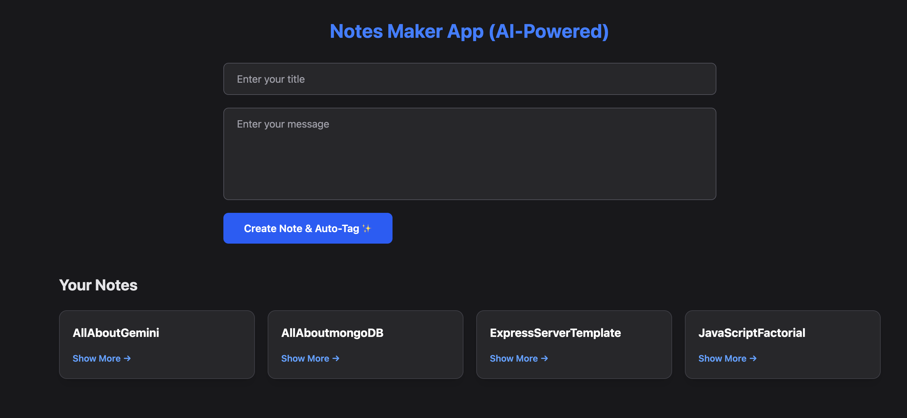

# 📝 Notes Maker App

A simple and responsive Notes Maker Web Application built using **Node.js, Express.js, EJS, and Tailwind CSS**.

This application allows users to create and view notes with a clean, modern, and user-friendly interface.

## 🚀 Features

- Create notes with a title and message.
- Display saved notes dynamically.
- View individual notes.
- Responsive design for mobile, tablet, and desktop.
- Modern dark-themed UI.
- Server-side rendering using EJS.
- Backend routing using Express.js.

## 🛠️ Technologies Used

- HTML5
- Tailwind CSS
- JavaScript
- Node.js
- Express.js
- EJS
- Google Gemini(API Key)

## 📸 Project Overview

The application provides a simple interface where users can enter a note title and message, submit the form, and view their saved notes.

## 📂 Project Setup

1. Clone the repository:

   ```bash
   git clone YOUR_REPOSITORY_URL
   ```

2. Navigate to the project directory:

   ```bash
   cd notes-maker-app
   ```

3. Install dependencies:

   ```bash
   npm install
   ```

4. Start the application:

   ```bash
   npm start
   ```

5. Open your browser and visit:

   ```text
   http://localhost:3000
   ```

## 🎯 Learning Objectives

- Understanding Node.js and Express.js.
- Working with EJS templates.
- Handling POST requests and form submissions.
- Implementing responsive layouts using Tailwind CSS.
- Added AI features for grammatical error and help.
- Practicing file handling and backend development.

## 📸 Screenshots

### 1. Home Dashboard (with AI Auto-Tags)



### 2. Note Detail View (with AI Features & Chat Modal)


## 👨‍💻 Author

**Ashish**

Developed with ❤️ by Ashish as a full-stack web development practice project.

---

⭐ If you like this project, consider giving it a star!
